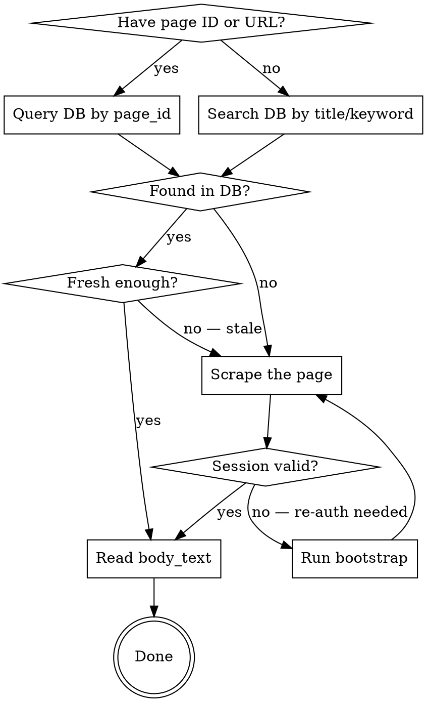

## Query

Confluence lookup requested: $ARGUMENTS

This skill runs in a forked subagent with no access to the calling conversation's
history — the line above (whatever page ID, URL, title, or keyword it contains) is the
only information it receives about what to look up. If it is empty, report that back
rather than guessing a page.

---

# Query Confluence Docs

## Trigger

Use when a request needs to read, check, look up, or reference Confluence documentation,
a spec, or the FOUND/ENG spaces — including any `sgwsagility.atlassian.net/wiki` URL.

## Overview

Always read Confluence via the local SQLite cache first. Only scrape if the page is missing or stale. **Never use WebFetch for Confluence URLs** — Confluence requires authentication and WebFetch will fail.

**DB location:** `~/.confluence-scraper/data.db`
**Scraper:** `~/projects/confluence-scraper`

## Steps

1. **Determine lookup key.** If `$ARGUMENTS` (or the caller's request) contains a page ID
   or URL, query the DB by `page_id`. Otherwise search the DB by title/keyword.
2. **Check the DB.** If found and fresh enough (see Key Notes below), read `body_text` and
   you're done.
3. **If missing or stale, scrape.** Check session validity first (`npm run bootstrap` if
   invalid), then scrape the page, then re-query the DB.
4. **Return `body_text`** (plain text, HTML stripped) as the result.

## Decision Flow



## Common Queries

**By page ID (from URL — 4th path segment):**
```bash
sqlite3 ~/.confluence-scraper/data.db \
  "SELECT title, body_text, last_scraped_at FROM pages WHERE page_id = '2140405764';"
```

**By title (exact or partial):**
```bash
sqlite3 ~/.confluence-scraper/data.db \
  "SELECT page_id, title, last_scraped_at FROM pages WHERE title LIKE '%Package Release%';"
```

**Full text search across a space:**
```bash
sqlite3 ~/.confluence-scraper/data.db \
  "SELECT page_id, title FROM pages WHERE space_key = 'FOUND' AND body_text LIKE '%migration%' LIMIT 10;"
```

**List all pages in a space:**
```bash
sqlite3 ~/.confluence-scraper/data.db \
  "SELECT page_id, title, last_scraped_at FROM pages WHERE space_key = 'FOUND' ORDER BY title;"
```

## Scraping a Page (if missing or stale)

**Node environment first:** the scraper needs the right Node version, loaded via `cd ~/projects/dgc-dev-proof-ecomm-web && nvm use`. `nvm use` only affects the current shell — run it in the SAME shell invocation as the npm command (shell state does not persist between Bash tool calls):

```bash
cd ~/projects/dgc-dev-proof-ecomm-web && nvm use && \
cd ~/projects/confluence-scraper && \
npm run scrape -- page "https://sgwsagility.atlassian.net/wiki/spaces/FOUND/pages/<PAGE_ID>/page-title"
```

Then query DB as above.

**If scrape fails with auth error — re-bootstrap (interactive, requires user):**
```bash
cd ~/projects/atlassian-auth && npm run bootstrap
# User completes SSO in browser, then presses Enter
```

## Scraping a Full Space

Same Node-environment precondition (and same-shell rule) as above.

```bash
cd ~/projects/dgc-dev-proof-ecomm-web && nvm use && \
cd ~/projects/confluence-scraper && \
npm run scrape -- space FOUND          # Skip already-scraped pages
# Append --force to re-scrape all pages: npm run scrape -- space FOUND --force
```

## Extract Page ID from URL

URL format: `/wiki/spaces/{SPACE_KEY}/pages/{PAGE_ID}/{title-slug}`

Example: `.../pages/2140405764/Package+Release+Process` → page ID is `2140405764`

## Key Notes

- `body_text` is plain text (HTML stripped) — use this for reading content
- `raw_html` is the full rendered HTML — use only if structure matters
- `last_scraped_at` tells you when the cache was last refreshed, NOT when the page was last edited. Treat a cached page as **stale** if either: (a) `last_scraped_at` is > 1 week old for frequently updated docs, or (b) you know the page changed since that timestamp (e.g. it was just updated via the REST API / update-confluence — writes go straight to Confluence and do not refresh this cache). Stale → re-scrape the page, then re-query.
- Bootstrap session is shared with the jira skill — stored at `~/.atlassian-auth/session.json` (see `~/projects/atlassian-auth`), consumed via the atlassian-auth CLI

## Network Unavailable

Cache reads (`sqlite3` queries) are fully local and work offline — always try them first regardless of connectivity. Only the scrape fallback needs the network. If a scrape is required but connectivity is unavailable: do not attempt it; return the cached content if any exists (flagging its `last_scraped_at` age), otherwise report that the page is uncached and scraping needs connectivity — do not fall back to WebFetch.

## Red flags

| Rationalization | What to do instead |
|---|---|
| "WebFetch is simpler, I'll just fetch the Confluence URL directly." | Confluence requires authentication — WebFetch will fail. Always go through the SQLite cache / scraper. |
| "The cache has a row, that's good enough regardless of age." | Check `last_scraped_at` — stale or known-changed pages must be re-scraped before trusting the content. |
| "No network, I'll try the scrape anyway and see what happens." | Return cached content (flagging its age) or report the page uncached — don't attempt a scrape with no connectivity. |

## Exit criteria

- [ ] `body_text` was returned from the DB, or a clear report that the page is uncached/
  unreachable — never a WebFetch fallback.
- [ ] A scrape, if performed, was followed by a re-query of the DB before returning content.

## Provenance

Provenance: Hermes skill `learnings/skill-sharing` (corpus-wide porting authorship
attestation: ADR 0010).
Lineage: X-context-docs skills/query-confluence@9d7143e
