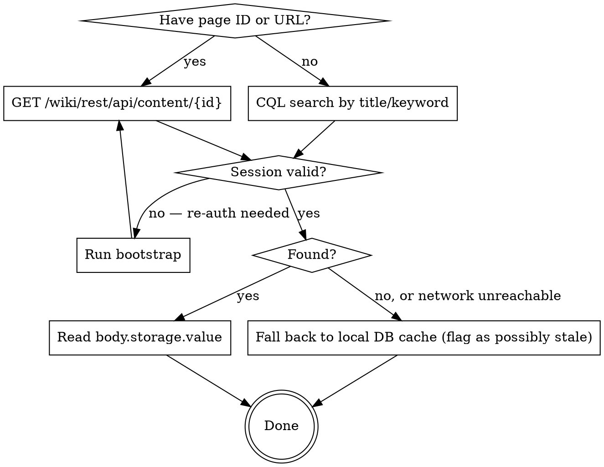

## Query

Confluence lookup requested: $ARGUMENTS

This skill runs in a forked subagent with no access to the calling conversation's
history — the line above (whatever page ID, URL, title, or keyword it contains) is the
only information it receives about what to look up. If it is empty, report that back
rather than guessing a page.

---

# Query Confluence Docs

## Trigger

Use when a request needs to read, check, look up, or reference Confluence documentation,
a spec, or the FOUND/ENG spaces — including any `sgwsagility.atlassian.net/wiki` URL.

## Overview

Default to the live Confluence REST API. **Never use WebFetch for Confluence URLs** —
Confluence requires authentication and WebFetch will fail; use the session-cookie-backed
`curl` calls below instead. The local SQLite cache below exists but has not been
refreshed in months — it is not queried by default; only fall back to it if the REST API
is unreachable (see Network Unavailable), and treat anything read from it as potentially
stale.

**DB (stale, explicit-fallback only):** `~/.confluence-scraper/data.db`
**Scraper:** `~/projects/confluence-scraper`
**Session (shared with the `jira` skill):** `~/.atlassian-auth/session.json` — see `~/projects/atlassian-auth`

Unlike the `jira` skill, Confluence's REST API has no gateway header-size limit — the
full, unfiltered cookie string from the atlassian-auth CLI works fine here. Do not apply
the `jira` skill's cookie-filtering step to Confluence calls; it isn't needed.

## Steps

1. **Check session freshness** before any REST call:

   ```bash
   cd ~/projects/atlassian-auth && npm run --silent cli -- status
   ```

   **If STALE — stop and tell the user:**
   > The Atlassian session has expired. Please run:
   > `cd ~/projects/atlassian-auth && npm run bootstrap`
   > Complete the SSO login in the browser, then press Enter. Re-run after.

2. **Get cookies** (unfiltered — see Overview):

   ```bash
   cd ~/projects/atlassian-auth && npm run --silent cli -- cookies
   ```

   Prints a ready-to-use `Cookie: name=value; name2=value2...` header string — use its
   output as `COOKIE_STRING` in the curl commands below.

3. **Determine lookup key and query the REST API directly.**

   **By page ID or URL** (page ID is the 4th path segment — see Extract Page ID from URL):
   ```bash
   curl -s "https://sgwsagility.atlassian.net/wiki/rest/api/content/2140405764?expand=body.storage" \
     -H "Cookie: COOKIE_STRING" -H "Accept: application/json" \
     | python3 -c "import sys,json; d=json.load(sys.stdin); print('Title:', d['title']); print(d['body']['storage']['value'])"
   ```

   **By title or keyword** (CQL search):
   ```bash
   curl -s --get "https://sgwsagility.atlassian.net/wiki/rest/api/content/search" \
     --data-urlencode 'cql=title~"Package Release" and space=FOUND' \
     -H "Cookie: COOKIE_STRING" -H "Accept: application/json"
   ```
   Adjust the `cql` value for the lookup — `text~"migration" and space=FOUND` for a
   full-text search, drop `and space=...` to search across all spaces, etc. Page IDs from
   the results feed back into the by-ID call above for full content.

4. **Return the page content** — `body.storage.value` is HTML (Confluence Storage
   Format); strip tags if plain text is needed.

## Decision Flow



## Local DB Fallback Only (stale — do not use by default)

```bash
sqlite3 ~/.confluence-scraper/data.db \
  "SELECT title, body_text, last_scraped_at FROM pages WHERE page_id = '2140405764';"
```
```bash
sqlite3 ~/.confluence-scraper/data.db \
  "SELECT page_id, title, last_scraped_at FROM pages WHERE title LIKE '%Package Release%';"
```

Only use these if explicitly asked for a cached/offline lookup, or if the REST API is
genuinely unreachable (see Network Unavailable) — always surface `last_scraped_at` to
the caller so they know how old the data is.

## Scraping a Page (legacy — only relevant to the DB fallback above, not the default path)

**Node environment first:** the scraper needs the right Node version, loaded via `cd ~/projects/dgc-dev-proof-ecomm-web && nvm use`. `nvm use` only affects the current shell — run it in the SAME shell invocation as the npm command (shell state does not persist between Bash tool calls):

```bash
cd ~/projects/dgc-dev-proof-ecomm-web && nvm use && \
cd ~/projects/confluence-scraper && \
npm run scrape -- page "https://sgwsagility.atlassian.net/wiki/spaces/FOUND/pages/<PAGE_ID>/page-title"
```

Then query DB as above.

**If scrape fails with auth error — re-bootstrap (interactive, requires user):**
```bash
cd ~/projects/atlassian-auth && npm run bootstrap
# User completes SSO in browser, then presses Enter
```

## Scraping a Full Space

Same Node-environment precondition (and same-shell rule) as above.

```bash
cd ~/projects/dgc-dev-proof-ecomm-web && nvm use && \
cd ~/projects/confluence-scraper && \
npm run scrape -- space FOUND          # Skip already-scraped pages
# Append --force to re-scrape all pages: npm run scrape -- space FOUND --force
```

## Extract Page ID from URL

URL format: `/wiki/spaces/{SPACE_KEY}/pages/{PAGE_ID}/{title-slug}`

Example: `.../pages/2140405764/Package+Release+Process` → page ID is `2140405764`

## Key Notes

- Live path: `body.storage.value` (HTML, Confluence Storage Format) and `title` come
  straight from the REST response — no freshness concern, it's the current page.
- DB-fallback path only: `body_text` is plain text (HTML stripped), `raw_html` is the
  full rendered HTML, and `last_scraped_at` tells you when the cache was last refreshed
  (NOT when the page was last edited) — treat it as stale and say so when returning it.
- Session is shared with the `jira` skill — stored at `~/.atlassian-auth/session.json`
  (see `~/projects/atlassian-auth`), consumed via the atlassian-auth CLI.

## Network Unavailable

The default path (REST API) needs the network. If connectivity is unavailable when this
skill is invoked:
- Fall back to the local DB cache (see Local DB Fallback Only above) if a matching row
  exists — always flag its `last_scraped_at` age when returning it.
- If no cached row exists either, report that the page is unreachable and the cache has
  nothing for it — do not fall back to WebFetch.

To verify connectivity before running: use the `network-check` skill.

## Red flags

| Rationalization | What to do instead |
|---|---|
| "WebFetch is simpler, I'll just fetch the Confluence URL directly." | Confluence requires authentication — WebFetch will fail. Always go through the REST API with session cookies. |
| "I'll query the local DB instead of the REST API." | The DB hasn't been refreshed in months — default to the live REST API; only use the DB as an explicit, flagged-stale fallback. |
| "No network, I'll try the REST call anyway and see what happens." | Fall back to the local DB cache (flagging its age) or report the page unreachable — don't attempt a REST call with no connectivity. |

## Exit criteria

- [ ] The live REST API was used by default; the local DB was only used as an explicit,
  flagged-stale fallback (missing network, or explicitly requested).
- [ ] WebFetch was never used for a Confluence URL.
- [ ] If the DB fallback was used, `last_scraped_at` was surfaced to the caller.

## Provenance

Provenance: Hermes skill `learnings/skill-sharing` (corpus-wide porting authorship
attestation: ADR 0010).
Lineage: X-context-docs skills/query-confluence@9d7143e.
2026-10-29: flipped default from DB-first to REST-API-first (the DB cache hadn't been
refreshed in months, per Xavier's request) — live reads now use
`GET /wiki/rest/api/content/{id}` for page-ID lookups and CQL search
(`GET /wiki/rest/api/content/search?cql=...`) for title/keyword lookups, both verified
working with the unfiltered atlassian-auth cookie string. The Decision Flow diagram was
updated to match rather than dropped, since (per the pre-existing note on the `jira`
skill) it still covers branches — session staleness, found/not-found, network-fallback —
that the Steps prose doesn't fully spell out. The DB/scraper is demoted to an explicit,
flagged-stale fallback only; nothing was deleted, since `update-confluence` still uses
the same DB for its own page-ID-by-title lookup (out of scope for this change).
